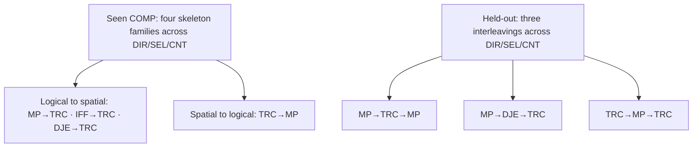

# SpatialEntail-SINGLE corpus and benchmark protocol

Status: production corpus sealed and four SFT jobs prepared, 2026-10-12.
The repository receipt does not track remote submission or completion. No frozen
benchmark evaluation result is claimed here.
This protocol supersedes the earlier 17K, seven-composition, and 5.8K-test plans.

## Research question and required study

Does SFT on solver-validated spatial problems improve answer accuracy on
matched, structurally held-out, and external spatial tasks?

The primary model is Qwen3.5-4B. The central SFT comparison is
`SpatialEntail-SINGLE-SFT`: answer-only and Natural worked-solution targets on
the same admitted base problems, with a prompt-matched untuned baseline.
`SINGLE` is the headline answer contract. Answer certificates remain offline
generation, verification, and evaluation artifacts; the model is not required to
reproduce them. The final fixed-epoch checkpoint is used, avoiding checkpoint
selection by training-target loss.

A compact CoS-like Symbolic arm is optional after the central study. Its purpose
is to test whether a shorter symbolic representation can retain accuracy while
reducing target and generated tokens; it is not the replayable NDJSON answer
certificate. A second model size, ALL_POSSIBLE training, distractor pairs,
extensive prompting factorials, and GRPO are also optional. SpatialMap-TQA-Corr
is the essential external anchor; StepGame is next priority. External suites
retain native contracts and are never pooled into the internal score.

## Separate artifacts

- **SpatialEntail-SINGLE-SFT:** matched answer-only and Natural supervision; an
  optional compact Symbolic view may be added only after its representation and
  token-reduction criterion are frozen.
- **SpatialEntail-SINGLE-Dev:** checkpoint diagnostics and the bounded size
  comparison.
- **SpatialEntail-SINGLE-Bench:** fixed evaluation modules, unavailable for
  selection.
- **Engineering pools:** previously inspected pilots, smoke runs, demonstrations,
  and debugging examples; logged in the contamination ledger.

The 650-row pilot informed generator fixes and is development evidence only.
P0 is also engineering-only. Its checkpoints never initialize central runs.

SODA names SPOD-143k as training data and SPOD-Bench as evaluation data. Its
paper does not establish row-level or structural disjointness. The approximate
79K benchmark size is an arithmetic inference from the stated 143K minus 64K,
not an exact audited row count. SODA motivates separate corpus and benchmark
roles, not our sample sizes, holdouts, or a new difficulty taxonomy. See the
[primary-source check](soda-task-taxonomy.md).

## Capability cells and composition contracts

The existing thirteen CORE entries remain feasibility/coverage strata, not
thirteen interchangeable primitive capabilities. UNI/ALT/MUL/NOM are semantic
strata; correlated Count is an evidence obligation; noisy Selection is a
robustness diagnostic. Report query-family and semantic summaries alongside
cell profiles. This choice is an explicit experimental distribution, not a
claim to represent all spatial reasoning.

The stronger hybrid study crosses four seen skeleton families and three
reserved skeleton families with every query contract (DIR/SEL/CNT):

| Role | Skeleton | Transition | Cells |
|---|---|---|---:|
| Train/matched | MP → TRC | implication-derived atom feeds spatial composition | 3 |
| Train/matched | IFF → TRC | equivalence-derived atom feeds spatial composition | 3 |
| Train/matched | TRC → MP | spatially derived antecedent activates an implication | 3 |
| Train/matched | DJE → TRC | disjunct elimination feeds spatial composition | 3 |
| Holdout | MP → TRC → MP | logical, spatial, then logical inference | 3 |
| Holdout | MP → DJE → TRC | two different Boolean rules feed spatial composition | 3 |
| Holdout | TRC → MP → TRC | spatial, logical, then spatial inference | 3 |

This yields twelve seen COMP cells and nine holdout cells. These are
query-contract instances of four seen and three unseen skeleton families;
nine holdout cells do not represent nine independent new reasoning families.
All have unique/invariant answer contracts, replayed positive query/member
proofs, consistent witnesses, and query-specific complete exclusions. All
use the same proof-template-first construction route. Selection targets use
explicit diagonal membership predicates; this limitation is reported rather
than claimed as full cardinal-direction coverage. All named non-reference
objects remain in the membership candidate domain for CORE and composition
modules. Deep Selection/Count evaluation explicitly names a fixed three-object
candidate scope so proof depth is not confounded with an exponentially growing
membership domain.

The old three-cell minimum was withdrawn: it confounded rule family with query
family and covered only logical-to-spatial transitivity. The strengthened
study adds reverse and interleaved transitions without additional model arms.

The admission contract is executable:

1. replay a positive query/member proof;
2. require distinct proof steps in the declared order, each an ancestor of the next;
3. remove each premise supporting that logical step individually;
4. require a consistent changed query answer domain after each intervention.

This rejects direct shortcuts and establishes bounded semantic dependence. It
does not claim a globally minimal or unique proof. Query/member candidates are
explicit; exact directions and all-object text round-trips remain unchanged.
Training compositions use two-edge spatial support. Separate controlled
training/development strata expose depths three and four; the deeper ladder
then measures extrapolation. `composition.py` rejects incompatible independent proof knobs.

The holdout contains three skeleton families. Claims apply to these specific
interleavings. All component rules appear during training; no claim of unseen
operator generalization is made.

## Evaluation modules

| Module | Sealed allocation | Interpretation |
|---|---:|---|
| CORE | 100 × 13 = 1,300 bases | coverage-stratum performance |
| COMP | 100 × 12 = 1,200 bases | seen skeletons, unseen instances |
| SHIFT | 1,800 bases | 900 held-out-composition plus 900 depth-ladder bases |
| Total benchmark | 4,300 bases | artifact count only, not one headline score |

Depth and composition have separate scorecards. Depth examples use one
consistent controlled generator across anchors and extrapolation. Report
entities, premises, input length, and achieved axis/member depths; depth effects
remain partially associated with these quantities. No length-independent causal
claim is made.

**Depth 8 remains an answer-accuracy target, not a requirement to emit full
traces.** Every gold answer is recomputed from complete solver semantics.
Selection/Count depth rows skip unused witness and answer-certificate rendering;
their three-candidate scope is explicit in the prompt and round-trips to the
structured query. The depth module uses admitted answer-only targets with
process validity marked not applicable. No truncation or shallower backfill is
allowed. All trained models are evaluated under the same direct-answer
instruction on the depth module.

## Allocation and training size

`release-candidate.yaml` supplied the now-sealed quotas: 200 bases per CORE
stratum (2,600), 350 per seen COMP cell (4,200), and 1,200 controlled depth-3/4
anchors, giving an 8K pool and nested 4K prefix. Dev contains 25 per each of the
31 CORE/COMP/anchor strata: 775 bases. Structural uniqueness, achieved-depth,
all-variant context, and marginal coverage audits passed before sealing. Equal
counts across query families within each skeleton reduce the earlier confound;
CORE and anchor weighting remain explicit. Report per-query, per-semantic,
direction/answer-position, and package token exposure. No extra examples are
added merely because a worked solution is longer or requested depth is larger.

Eight thousand bases is the sealed SFT allocation. The nested 4K subset remains
an available data artifact, not a required scaling experiment. The former 16K
expansion is not part of the current study.

Use a keyed random rank within strata for nested prefixes. Freeze prompts,
training epochs, tokenizer revision, decoding, and score definitions before
central runs. Use pre-existing engineering pools for generator/prompt tuning;
ordinary Dev is not a license for repeated redesign. Final test never selects
size, prompts, epochs, or checkpoints.

## Leakage and sealing

Two grouping keys serve different purposes:

- **Instance signature:** existing versioned visible-problem canonicalizer,
  ignoring entity names and premise/commutative order, retaining exact
  directions. It is syntactic isomorphism, not logical equivalence; rotations
  and semantically equivalent formulas remain an explicit limitation.
- **Skeleton signature:** versioned declared construction-family key. Matched
  tests may share its family; holdouts reserve the family from train/dev.
  It does not classify arbitrary natural formulas by proof equivalence.

The assembler rejects shared base IDs, exact prompts, and instance signatures
within and across production splits. All trace variants remain grouped. It
records signature versions, conservative fallback counts, unique counts,
contamination-input hashes, software revision/dirty state, and token totals.
Engineering-only smoke may allow repeated structures; its flag forbids claims
of structural generalization. A candidate release never silently relaxes the
production uniqueness gate. Insufficient distinct structures fail the quota
and require a protocol revision before the benchmark is sealed.

Sealing requires: all quotas met; formal/replay/round-trip/context checks pass;
coverage and overlap audits pass; quality receipts recorded; and manifests and
hashes fixed. The builder marks output candidate-awaiting-quality-review,
not frozen. Log final benchmark accesses. Any benchmark-informed generator
repair requires a new benchmark version and fresh instances. Do not submit final
benchmark traces to an evaluated judge-model family and then claim that family
has guaranteed contamination-free evaluation.

## Statistical reporting

Primary outcomes on `SpatialEntail-SINGLE-Bench` are strict accuracy for CORE,
COMP, and SHIFT. Every formal group reports its cumulative score plus
cell-level diagnostics under the same reporting rule. SHIFT records
held-out-composition and depth-ladder labels as cell metadata, and depth
additionally uses family-by-depth curves. Query and cell summaries remain
descriptive rather than independent populations. No whole-benchmark headline is
used.

At 100 examples, a cell near 50% accuracy has an approximate 95% half-width of
9.6 points. Cells support descriptive profiles and large effects, not small
rankings. The primary comparison is Natural versus answer-only on held-out COMP.
Use cell-stratified paired bootstrap/permutation recomputing macro differences;
resample base problems together with their variants. Report within-skeleton
results without treating three skeleton families as hundreds of independent
generalization units. If the optional compact Symbolic arm runs, report its
accuracy and token/runtime delta as a secondary comparison rather than adding it
to the central family of tests.

Two seeds are reported individually and with descriptive mean/range. Item
intervals are conditional on the checkpoints and do not measure training-run
variance. Consistent signs are evidence from two runs, not a stable estimate of
robustness over randomness. Token/update/runtime accounting accompanies all
fixed-example comparisons. A negative learning result remains informative for
the semantic audit and supervision-package comparison.

## Quality review and user workload

Preserve the authorized sequential DeepSeek-V4-Pro then GPT-5.5 screen, split
hold-out, and human appeal only on double rejection. Review is batched into
immutable packets; each batch keeps judge isolation and model order. Sample
Train/Dev/Bench separately with minimum representation for each cell and new
constructor. Record sampling probabilities and stratum counts; distinguish
probability samples from risk-based long-trace/edge-case checks.

This establishes passing the automated presentation screen. It cannot estimate
population human acceptability or false acceptance. A separate random human
audit would strengthen a public language-quality claim, but it is not activated
because the user requested selective human involvement only. Until separately
authorized, describe the artifact as a formally validated synthetic experimental
corpus; do not report a human-validated benchmark claim. In the executed screen,
all 485 sampled items received two approvals, so no human appeal was triggered.
Report this as two independent blinded LLM reviews, not a double-blind human
review.

## Runnable verification paths and final release state

- `python -m spatial.v2.legacy.check_registry spatial/v2/composition-cells.yaml --probe`
- `python -m spatial.v2.legacy.check_registry spatial/v2/composition-holdout-cells.yaml --probe`
- `python -m spatial.v2.study.build spatial/v2/study/smoke.yaml --out <new-dir>`
- P0 launcher: `experiments/15-v2-ablation/run-core-smoke.yaml`, with thirteen
  CORE cells, exact context admission, engineering dev/test, and one Natural
  training arm. It is an engineering configuration, not a sealed final study.

The production release contains 8,000 Train, 775 Dev, and 4,300 Bench bases.
All quotas, structural uniqueness, cross-role overlap, achieved-depth,
round-trip, semantic re-solving, Symbolic replay, and context gates passed.
The four Qwen3.5-4B answer-only/Natural job configurations are prepared but have
not been submitted from this repository.

### Diversity repair after independent review

The pilot-size DIR-ARC template and minimal depth chains could not meet production
quotas with unique signatures. Production therefore used a larger six-object
direct-relation policy and randomized support-independent filler-edge subsets
for depth ladders; membership fillers vary the nonmember quadrant. A depth-three
Direction probe produced thirty unique structures from thirty candidates while
retaining X/Y depth three. This repairs the fixed-topology bottleneck but does
not establish full quotas or long-trace admission. All train/dev/test policies
for an anchor use the same expanded domain/topology recipe.

### Sealed context envelope

The sealed release records a conservative 12,288-token training envelope and a
16,384-token evaluation envelope. Central answer-only/Natural jobs retain those
admission limits so the sealed data and receipts remain reproducible; the limits
are not evidence that ordinary Natural SFT requires that much context. Report
actual target lengths and runtime. Depth-eight answer-only checks remain
separate from the worked-solution envelope.

## Release-to-SFT job endpoint

The completed preparation goal stopped at creation of four SFT configs/scripts;
no Slurm job was submitted. `study/feasibility.py` records
structural yield and exact token admission. `study/seal.py` checks all roles,
paired targets, overlap, hashes, and release-linked judge receipts before
sealing. `study/jobs.py` refuses engineering/unsealed data and writes paired
Train/Dev package views, pinned Axolotl configs, and repository-relative Slurm
scripts for seeds 42/43. See the [execution guide](../../../spatial/v2/study/README.md).

Production ambiguity and no-match Selection policies now use larger independent
object trees/star exclusions. Boolean and hybrid budget fillers vary object
pairs and directions without altering query support. These additions affect
syntactic diversity, not measured proof difficulty; report both and never claim
that unique whole-problem signatures imply unique core reasoning skeletons.
