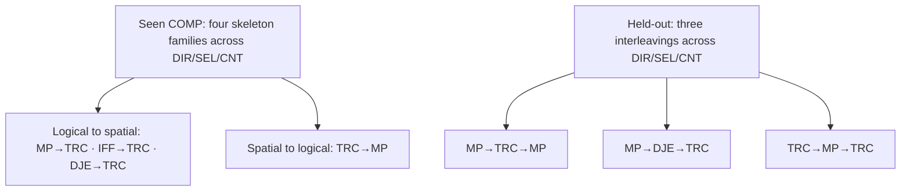

# SpatialEntail corpus and benchmark protocol

Status: reviewed design implemented as candidate configurations, 2026-10-11.
No production corpus, sealed benchmark, selected size, or SFT result is claimed.
This protocol supersedes the earlier 17K, seven-composition, and 5.8K-test plans.

## Research question and required study

Does formally checked spatial evidence improve answer accuracy on matched and
held-out logical-spatial structures compared with answer-only task exposure?

The primary model is Qwen3.5-4B. Answer-only, checked Natural, and checked
Symbolic SFT use the same admitted base problems and two seeds (42 and 43): six
central training runs. Each receives an appropriate prompt-matched untuned
baseline. SINGLE is the headline contract. Natural versus Symbolic compares
supervision packages, not notation alone. The final fixed-epoch checkpoint is
used, avoiding format-dependent checkpoint selection by token loss.

A second model size, corrupted traces, local-proof serialization, ALL_POSSIBLE
training, distractor pairs, extensive prompting factorials, and GRPO are
optional after the central study. SpatialMap-TQA-Corr is the essential external
anchor; StepGame is next priority. External suites retain native contracts and
are never pooled into the internal score.

## Separate artifacts

- **SpatialEntail-Train:** paired answer-only/Natural/Symbolic supervision.
- **SpatialEntail-Dev:** checkpoint diagnostics and the bounded size comparison.
- **SpatialEntail-Bench:** fixed evaluation modules, unavailable for selection.
- **Engineering pools:** previously inspected pilots, smoke runs, demonstrations,
  and debugging examples; logged in the contamination ledger.

The 650-row pilot informed generator fixes and is development evidence only.
P0 is also engineering-only. Its checkpoints never initialize central runs.

SODA names SPOD-143k as training data and SPOD-Bench as evaluation data. Its
paper does not establish row-level or structural disjointness. The approximate
79K benchmark size is an arithmetic inference from the stated 143K minus 64K,
not an exact audited row count. SODA motivates separate corpus and benchmark
roles, not our sample sizes, holdouts, or a new difficulty taxonomy. See the
[primary-source check](soda-task-taxonomy.md).

## Capability cells and composition contracts

The existing thirteen CORE entries remain feasibility/coverage strata, not
thirteen interchangeable primitive capabilities. UNI/ALT/MUL/NOM are semantic
strata; correlated Count is an evidence obligation; noisy Selection is a
robustness diagnostic. Report query-family and semantic summaries alongside
cell profiles. This choice is an explicit experimental distribution, not a
claim to represent all spatial reasoning.

The stronger hybrid study crosses four seen skeleton families and three
reserved skeleton families with every query contract (DIR/SEL/CNT):

| Role | Skeleton | Transition | Cells |
|---|---|---|---:|
| Train/matched | MP → TRC | implication-derived atom feeds spatial composition | 3 |
| Train/matched | IFF → TRC | equivalence-derived atom feeds spatial composition | 3 |
| Train/matched | TRC → MP | spatially derived antecedent activates an implication | 3 |
| Train/matched | DJE → TRC | disjunct elimination feeds spatial composition | 3 |
| Holdout | MP → TRC → MP | logical, spatial, then logical inference | 3 |
| Holdout | MP → DJE → TRC | two different Boolean rules feed spatial composition | 3 |
| Holdout | TRC → MP → TRC | spatial, logical, then spatial inference | 3 |

This yields twelve seen COMP cells and nine holdout cells. These are
query-contract instances of four seen and three unseen skeleton families;
nine holdout cells do not represent nine independent new reasoning families.
All have unique/invariant answer contracts, replayed positive query/member
proofs, consistent witnesses, and query-specific complete exclusions. All
use the same proof-template-first construction route. Selection targets use
explicit diagonal membership predicates; this limitation is reported rather
than claimed as full cardinal-direction coverage. All named non-reference
objects remain in the membership candidate domain.

The old three-cell minimum was withdrawn: it confounded rule family with query
family and covered only logical-to-spatial transitivity. The strengthened
study adds reverse and interleaved transitions without additional model arms.

The admission contract is executable:

1. replay a positive query/member proof;
2. require distinct proof steps in the declared order, each an ancestor of the next;
3. remove each premise supporting that logical step individually;
4. require a consistent changed query answer domain after each intervention.

This rejects direct shortcuts and establishes bounded semantic dependence. It
does not claim a globally minimal or unique proof. Query/member candidates are
explicit; exact directions and all-object text round-trips remain unchanged.
Training compositions use two-edge spatial support. Separate controlled
training/development strata expose depths three and four; the deeper ladder
then measures extrapolation. `composition.py` rejects incompatible independent proof knobs.

The holdout contains three skeleton families. Claims apply to these specific
interleavings. All component rules appear during training; no claim of unseen
operator generalization is made.

## Evaluation modules

| Module | Provisional allocation | Interpretation |
|---|---:|---|
| CORE matched | 100 × 13 = 1,300 bases | coverage-stratum performance |
| COMP matched | 100 × 12 = 1,200 bases | seen skeletons, unseen instances |
| COMP holdout | 100 × 9 = 900 bases | transfer to three reserved skeleton families |
| Depth | 50 × 3 query families × depths 3–8 = 900 bases | 3/4 matched anchors; 5–8 extrapolation |
| Total candidate benchmark | 4,300 bases | artifact count only, not one headline score |

Depth and composition have separate scorecards. Depth examples use one
consistent controlled generator across anchors and extrapolation. Report
entities, premises, input length, and achieved axis/member depths; depth effects
remain partially associated with these quantities. No length-independent causal
claim is made.

**Depth 8 remains an answer-accuracy target, not a requirement to emit full
traces.** Gold answers/certificates are formally validated offline. Deep SEL/CNT
proof traces exceed the existing output envelope. The depth module uses admitted
answer-only targets with process validity not applicable. No truncation or
shallower backfill is allowed. Natural/Symbolic process results apply only to
CORE/COMP examples admitted as a complete paired group. All trained models are
also evaluated under the same direct-answer instruction on the depth module;
this is separate from their native trace-generation evaluations.

## Allocation and training size

`release-candidate.yaml` contains feasibility targets: 200 bases per CORE
stratum (2,600), 350 per seen COMP cell (4,200), and 1,200 controlled depth-3/4
anchors, giving an 8K pool and nested 4K prefix. Dev contains 25 per each of the
31 CORE/COMP/anchor strata: 775 bases. These remain budget targets until
structural uniqueness, achieved-depth, all-variant context, and marginal
coverage audits pass. Equal counts across query families within each skeleton
reduce the earlier confound; CORE and anchor weighting remain explicit.
Report per-query, per-semantic, direction/answer-position, and package token
exposure before approving quotas. No extra examples are added merely because
a trace is longer or requested depth is larger.

One bounded 4K→8K checked-Symbolic comparison uses development only. Eight
thousand is the primary budget candidate, not evidence of saturation. Report
observed gains, paired uncertainty, and both seeds when feasible. The old
“less than two points proves saturation” rule is withdrawn. If uncertainty or
run variance is unresolved, report “not resolved within budget.” A 16K pool is
optional future expansion, not part of the central critical path.

Use a keyed random rank within strata for nested prefixes. Freeze prompts,
training epochs, tokenizer revision, decoding, and score definitions before
central runs. Use pre-existing engineering pools for generator/prompt tuning;
ordinary Dev is not a license for repeated redesign. Final test never selects
size, prompts, epochs, or checkpoints.

## Leakage and sealing

Two grouping keys serve different purposes:

- **Instance signature:** existing versioned visible-problem canonicalizer,
  ignoring entity names and premise/commutative order, retaining exact
  directions. It is syntactic isomorphism, not logical equivalence; rotations
  and semantically equivalent formulas remain an explicit limitation.
- **Skeleton signature:** versioned declared construction-family key. Matched
  tests may share its family; holdouts reserve the family from train/dev.
  It does not classify arbitrary natural formulas by proof equivalence.

The assembler rejects shared base IDs, exact prompts, and instance signatures
within and across production splits. All trace variants remain grouped. It
records signature versions, conservative fallback counts, unique counts,
contamination-input hashes, software revision/dirty state, and token totals.
Engineering-only smoke may allow repeated structures; its flag forbids claims
of structural generalization. A candidate release never silently relaxes the
production uniqueness gate. Insufficient distinct structures fail the quota
and require a protocol revision before the benchmark is sealed.

Sealing requires: all quotas met; formal/replay/round-trip/context checks pass;
coverage and overlap audits pass; quality receipts recorded; manifests/hashes
fixed; operator review. The builder marks output candidate-awaiting-quality-review,
not frozen. Log final benchmark accesses. Any benchmark-informed generator
repair requires a new benchmark version and fresh instances. Do not submit final
benchmark traces to an evaluated judge-model family and then claim that family
has guaranteed contamination-free evaluation.

## Statistical reporting

Primary outcomes are cell-macro strict accuracy separately for matched CORE,
matched COMP, and held-out COMP; depth uses family-by-depth curves. Cell macro
means the unweighted average of the frozen cell accuracies. Query summaries
average their declared cells, and allocation-weighted micro scores are
secondary. Overlapping RR/LR/MTR summaries are descriptive, not independent
populations. No aggregate SHIFT or whole-benchmark headline is used.

At 100 examples, a cell near 50% accuracy has an approximate 95% half-width of
9.6 points. Cells support descriptive profiles and large effects, not small
rankings. The primary comparisons are Natural versus answer-only and Symbolic
versus answer-only on held-out COMP; apply Holm correction to those two tests
within each seed. Use cell-stratified paired bootstrap/permutation recomputing
macro differences; resample base problems together with their variants. Report
within-skeleton results, without treating three skeleton families as hundreds of
independent generalization units.

Two seeds are reported individually and with descriptive mean/range. Item
intervals are conditional on the checkpoints and do not measure training-run
variance. Consistent signs are evidence from two runs, not a stable estimate of
robustness over randomness. Token/update/runtime accounting accompanies all
fixed-example comparisons. A negative learning result remains informative for
the semantic audit and supervision-package comparison.

## Quality review and user workload

Preserve the authorized sequential DeepSeek-V4-Pro then GPT-5.5 screen, split
hold-out, and human appeal only on double rejection. Review is batched into
immutable packets; each batch keeps judge isolation and model order. Sample
Train/Dev/Bench separately with minimum representation for each cell and new
constructor. Record sampling probabilities and stratum counts; distinguish
probability samples from risk-based long-trace/edge-case checks.

This establishes passing the automated presentation screen. It cannot estimate
population human acceptability or false acceptance. A separate random human
audit would strengthen a public language-quality claim, but it is not activated
because the user requested selective human involvement only. Until separately
authorized, describe the artifact as a formally validated synthetic experimental
corpus; do not report a human-validated benchmark claim.

## Runnable paths and remaining release gates

- `python -m spatial.v2.check_registry spatial/v2/composition-cells.yaml --probe`
- `python -m spatial.v2.check_registry spatial/v2/composition-holdout-cells.yaml --probe`
- `python -m spatial.v2.study.build spatial/v2/study/smoke.yaml --out <new-dir>`
- P0 launcher: `experiments/15-v2-ablation/run-core-smoke.yaml`, with thirteen
  CORE cells, exact context admission, engineering dev/test, and one Symbolic
  training arm. It is an engineering configuration, not a sealed final study.

The production assembler exists, but full candidate quotas, coverage, quality,
and final release are not executed. The current constructors may exhaust their
unique structural diversity at the requested sizes. That is a release blocker,
not permission to substitute renamed copies. Large training is not launched by
this protocol update.

### Diversity repair after independent review

The pilot-size DIR-ARC template and minimal depth chains cannot meet production
quotas with unique signatures. Candidate production now uses a larger six-object
direct-relation policy and randomized support-independent filler-edge subsets
for depth ladders; membership fillers vary the nonmember quadrant. A depth-three
Direction probe produced thirty unique structures from thirty candidates while
retaining X/Y depth three. This repairs the fixed-topology bottleneck but does
not establish full quotas or long-trace admission. All train/dev/test policies
for an anchor use the same expanded domain/topology recipe.

### Candidate trace envelope

Expanded SEL/CNT depth-three/four anchors do not admit paired Symbolic targets
under 4,096 tokens: representative full-training counts were 5,843/8,252 for
Selection and 6,112/8,568 for Count. Production candidate therefore reserves
12,288 training/output tokens within a 16,384 evaluation envelope. The small
engineering smoke remains at 4,096/8,192. This is an unsealed compute choice,
not permission to truncate or mix token budgets across compared arms. Record
actual costs and retain all-or-none paired admission. Depth-eight answer-only
checks remain separate from this full-trace envelope.
