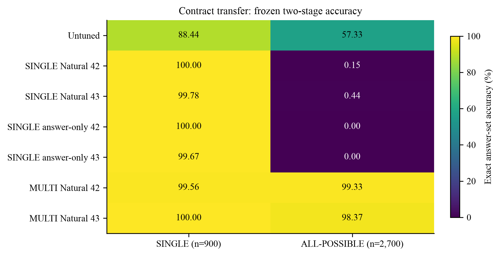
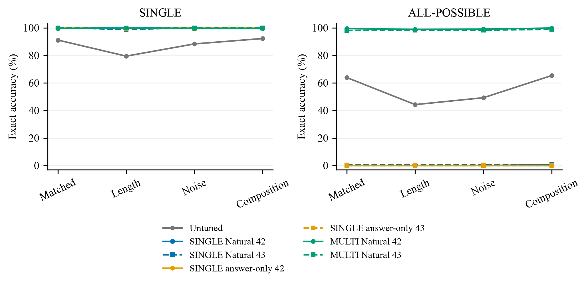
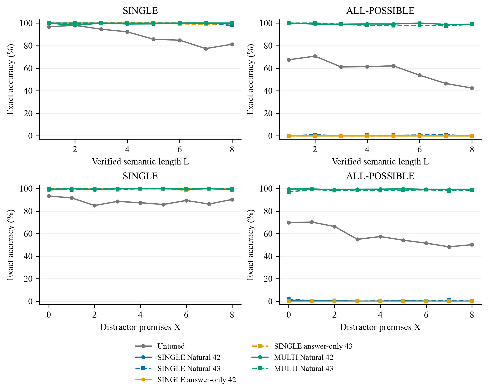
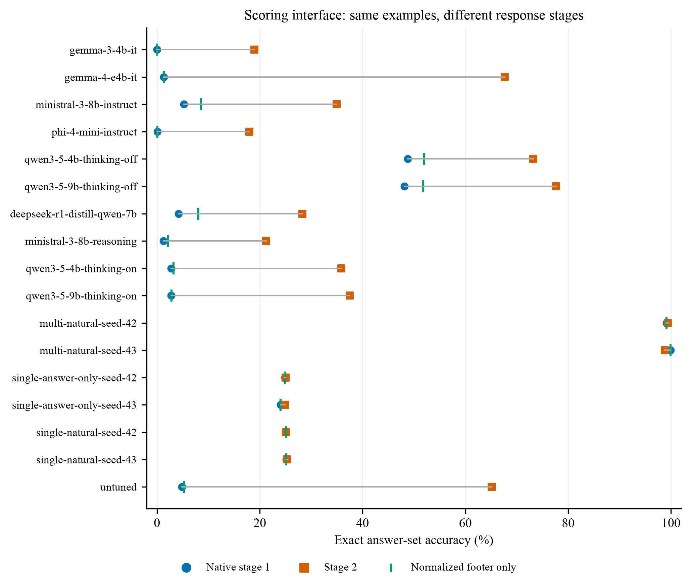

# Randomized-v2: Research Analysis

## Bottom Line

The strongest result is **asymmetric transfer across answer contracts**. SINGLE
training reaches the SINGLE ceiling but usually returns one option on
ALL-POSSIBLE questions. MULTI Natural performs well on both contracts. This is a
result about these checkpoints, this benchmark, and the frozen two-stage
protocol, not proof of a general reasoning mechanism.

The audit also establishes that **stage 2 is a consequential model generation,
not a harmless answer extractor**. It improves many baseline scores but changes
40 correct ALL-POSSIBLE answers into wrong ones for MULTI Natural seed 43.

No original evaluation results or scoring code were changed. External transfer
has been prepared but has not run.

## 1. Evidence and Integrity

Audited 17 complete runs, each on the same 3,600 base examples: 61,200 saved
responses in total. There are 900 SINGLE and 2,700 ALL-POSSIBLE examples per run.
These are repeated measurements, not 61,200 independent benchmark problems.

Checks completed:

- Replayed all saved responses through the actual `process_results_v2_answer`
  scorer: all strict, loose, native stage-1, and format metrics reproduced.
- Matched every saved prompt to the system/user messages of the hash-bound
  benchmark source. Zero mismatches and zero scanned audit-field markers.
  Comparator arguments store pre-template messages, not the actual
  tokenizer-rendered prompt; this verifies their payloads, not every native
  template's runtime behavior.
- Verified the training manifest against the downloaded six-job preparation
  receipt, all six candidate-file hashes, and the excluded benchmark hash.
- Found zero benchmark overlaps by base ID, recorded canonical structure
  signature, or exact user text in any train/development file.
- Found zero train/development signature overlap and zero held-out transitions
  in the recorded training/development proof profiles.
- Found exactly one distinct reserved transition in every COMPOSITION-OOD
  proof profile, and none in the other benchmark partitions.

**Limits:** canonical signatures and proof profiles are generator-authored.
This run did not independently replay all internal solver certificates or test
every form of semantic near-duplication. Preparation receipts do not establish
which files the cluster actually consumed. Final adapter hashes, training logs,
completion receipts, and tokenizer/runtime provenance still need collecting.
Nothing here audits base-model pretraining contamination.

Machine-readable evidence: [provenance](provenance.json),
[input hashes](input_hashes.json), and [interface audit](interface.csv).

## 2. Contract Transfer

All accuracies below use the original stage-2 exact answer-set metric.

| Checkpoint | SINGLE, n=900 | ALL-POSSIBLE, n=2,700 | Singleton output on ALL-POSSIBLE |
|---|---:|---:|---:|
| Untuned | 88.44% | 57.33% | 10.44% |
| SINGLE Natural 42 | 100.00% | 0.15% | 98.48% |
| SINGLE Natural 43 | 99.78% | 0.44% | 96.37% |
| SINGLE answer-only 42 | 100.00% | 0.00% | 97.96% |
| SINGLE answer-only 43 | 99.67% | 0.00% | 96.11% |
| MULTI Natural 42 | 99.56% | 99.33% | 0.07% |
| MULTI Natural 43 | 100.00% | 98.37% | 1.04% |

**Not just a cardinality error.** Of the 2,700 ALL-POSSIBLE cases, SINGLE
Natural 42/43 have 1,675/1,767 strict-subset errors, but also 999/886 errors
with both missing and incorrect options. Answer-only 42/43 have 932/953
strict-subset errors and 1,767/1,745 mixed errors. Simply emitting more options
would not guarantee the correct answer set.

Interpretation: the results are consistent with SINGLE specialization and poor
contract transfer. They do not distinguish a learned response habit from a
failure to establish the full semantic possibility set. SINGLE and MULTI use
different training distributions with shared subsets, not an instruction-only
ablation on otherwise identical examples.

See [contract metrics](contracts.csv), [cardinality distributions](cardinality.csv),
and [query breakdowns](query.csv).

## 3. Paired Comparisons

Every contrast pairs the same base IDs, checks matching target/difficulty
metadata, and reports seeds separately. Bootstrap intervals resample paired
examples within query x G x partition cells, then equally weight cells.
There are 2,000 draws with seed 42. Micro differences retain example weighting;
the bootstrap estimates below use cell-macro weighting.

| MULTI minus untuned | Contract | Wins / losses | Micro change | Cell-macro change, 95% interval |
|---|---|---:|---:|---:|
| Seed 42 | SINGLE | 104 / 4 | +11.11 pp | +11.81 [9.65, 14.10] pp |
| Seed 43 | SINGLE | 104 / 0 | +11.56 pp | +12.22 [10.07, 14.44] pp |
| Seed 42 | ALL-POSSIBLE | 1,144 / 10 | +42.00 pp | +43.61 [41.78, 45.60] pp |
| Seed 43 | ALL-POSSIBLE | 1,130 / 22 | +41.04 pp | +42.73 [40.81, 44.68] pp |

These are **checkpoint-conditional, fixed-suite intervals**, not uncertainty
over training seeds, new proof skeletons, or new tasks. They are descriptive
post-hoc contrasts, not a preregistered multiple-comparison significance claim.
A zero-width interval for identical predictions does not prove equivalence.

For SINGLE Natural versus answer-only, seed 42 ties at 900/900. Seed 43 has
three paired wins and two losses for Natural: +0.11 pp micro, with cell-macro
interval [-0.49, +0.63] pp. There is no clear Natural accuracy advantage here.
There is no MULTI answer-only arm, so MULTI's success cannot be attributed
specifically to its explanations.

Full contrasts: [paired estimates](paired.json).

## 4. Structural Generalization

MULTI Natural's aggregate COMPOSITION-OOD accuracy is 99.72% for seed 42 and
99.17% for seed 43. The source audit confirms that the reserved transitions
are absent from the candidate training proof profiles. This supports transfer
to **this implemented held-out-transition test**, not unrestricted systematic
reasoning.

The untuned baseline degrades on longer ALL-POSSIBLE problems; MULTI stays
near ceiling across the observed L and X ranges. These are marginal curves.
Query, G, L, X, and partition mixtures differ across points. They do not
estimate the causal effect of adding one reasoning step or one distractor.
No matched-counterfactual noise experiment was performed.

The CSVs retain each point's denominator: [partitions](partitions.csv),
[length](length.csv), [noise](noise.csv). All figures also have vector PDF
versions beside the displayed PNGs.

## 5. Generation and Scoring Interface

Three diagnostic hypotheses were tested:

1. **Unfinished generation:** Qwen-4B thinking-on has 3,422/3,600 responses
   (95.06%) that re-encode to at least 4,094 tokens against a 4,096-token
   budget. On ALL-POSSIBLE the count is 2,655/2,700 (98.33%).
   A captured Count example stops mid-sentence after repeatedly deriving the
   correct count, with no final answer. The untuned SFT baseline is also near
   budget in 3,391/3,600 cases. This strongly motivates a budget/termination
   investigation; it does not establish actual finish reasons.
2. **Extraction sensitivity:** removing Markdown emphasis/backticks and a
   terminal closing think tag, while still requiring an explicit terminal
   answer, recovers 15 Qwen-4B thinking-on answers: overall 2.78% to 3.19%.
   This small improvement does not explain its low score. The same diagnostic
   moves DeepSeek from 4.19% to 8.06% and Ministral Instruct from 5.22% to 8.56%.
   It is conservative and not an exhaustive semantic answer extractor.
3. **Stage-2 answer changes:** MULTI seed 43 has 40 correct-to-wrong changes,
   all on ALL-POSSIBLE, and no wrong-to-correct gains. That slice drops from
   99.85% native stage 1 to 98.37% stage 2. In a retained example, the native
   final `C, D` becomes `D`, although the reasoning states both possible counts.
   Conversely, MULTI seed 42 gains ten answers and loses none overall.

**Confirmed behavior:** stage 2 is a fresh constrained generation, not
deterministic extraction. It may discard a correct answer. In the current
continuation code, `Answer:` footer lines are removed, but bare final letters
remain. Thinking-model continuations do not insert a missing closing think
tag. These are candidate interface mechanisms, not yet experimentally isolated
causes of the observed errors.

Saved outputs do not retain finish reasons, emitted token IDs, or the complete
stage-2 runtime prompt. Token counts above are re-encoding proxies using the
cached pinned Qwen-4B tokenizer, not direct vLLM token counts. Other families
were not counted with that tokenizer.

Do not replace headline results with the best of the two stages. Keep the
original metric and publish both diagnostics. Do not claim "thinking harms
reasoning" from the current panel: budgets, decoding settings, templates, and
continuation behavior are intertwined.

Traceable cases: [examples with source file and line](examples.csv).

## 6. Next Experiments

**First: current Corr transfer.** The locally prepared package evaluates the
untuned baseline plus all six adapters on the current 1,500-row SINGLE Corr
definition. This asks whether learning transfers to a different source and
explicit underdetermination, not whether ALL-POSSIBLE transfer generalizes.
The legacy 1,329-row Corr task and the old "None of these is proven" task are
different datasets/contracts and must not be substituted.

**Second: a bounded interface diagnostic, not a new leaderboard.** Use a
frozen, disjoint diagnostic sample for tuning. Record actual token counts,
finish reasons, and both runtime prompts. Hold the checkpoint and decoding
settings fixed while changing one factor at a time: reasoning budget,
termination/closing-think handling, or answer selection. Any changed protocol
needs a new version and paired reruns; do not overwrite these result folders.
The retained failure cases are debugging examples, not an unbiased test set.

**Later, optional:** MULTI answer-only or matched-content contract training
would help isolate supervision mechanisms. These are new training experiments,
not prerequisites for describing the present findings.

## 7. Reproduction and Validation

See [RUNBOOK.md](RUNBOOK.md) for exact local reproduction and cluster commands.
The full internal audit replayed 61,200 responses successfully. The focused
automated regression run passed 26 tests and 5 subtests. The prepared transfer
package passed all file/environment hashes, all 1,500 gold-answer scoring
replays, seven config/adapter-path checks, and shell syntax checks.
All four figures were visually inspected.

No GPU inference, model re-training, or cluster submission was performed.
The external runtime and training-completion provenance remain unverified.
